# VBC - Video Batch Compression

**Production-grade batch video compression tool with real-time UI and event-driven clean architecture.**

VBC compresses video libraries to AV1 using GPU (NVENC) or CPU (SVT-AV1) with intelligent queue management, camera-specific quality presets, and automatic rotation. Built for photographers, videographers, and content creators managing large video collections.

---

[](https://www.python.org/downloads/)
[](LICENSE)
[](docs/)
[](docs/development/testing.md)

---

## Table of Contents

- [Why VBC?](#why-vbc)
- [Key Features](#key-features)
- [Demo & Screenshots](#demo--screenshots)
- [How It Works](#how-it-works)
- [Quick Start](#quick-start)
- [Installation](#installation)
- [Configuration](#configuration)
- [Usage](#usage)
  - [CLI Reference](#cli-reference)
  - [Runtime Controls](#runtime-controls)
- [Architecture](#architecture)
- [Advanced Features](#advanced-features)
- [Troubleshooting](#troubleshooting)
- [Development](#development)
- [Contributing](#contributing)
- [License](#license)

---

## Why VBC?

Modern video libraries grow fast. Raw 4K footage from cameras and drones consumes terabytes of storage. VBC solves this with:

- **Massive Space Savings**: AV1 codec achieves 30-70% size reduction vs H.264/HEVC
- **Quality Preservation**: Perceptually lossless compression with configurable quality targets
- **Batch Efficiency**: Process thousands of files with smart queue management and parallel processing
- **Camera Intelligence**: Apply different quality settings per camera model automatically
- **Real-Time Control**: Adjust threads, monitor progress, gracefully stop/resume without losing work

**Perfect for**: Photographers with mixed camera libraries, drone pilots with rotated footage, content creators archiving projects, anyone with 500GB+ of video needing organization.

---

## Key Features

### Compression & Quality
- ✅ **AV1 Encoding**: GPU (NVENC) for speed or CPU (SVT-AV1) for maximum quality
- ✅ **Dynamic Quality**: Camera-specific quality presets (e.g., Sony A7RV at CQ38, DJI at CQ45)
- ✅ **Manifest Queue**: Dynamically ingest JSON requests and concatenate multipart recordings in one FFmpeg pass
- ✅ **Smart Filtering**: Skip AV1-already-encoded files, filter by camera model, size thresholds
- ✅ **Min Ratio Check**: Keep original if compression savings below threshold (default 10%)
- ✅ **Color Space Fixes**: Automatic recovery for FFmpeg 7.x "reserved" color space bugs

### Processing & Performance
- ✅ **Multi-Threaded**: Concurrent compressions with runtime adjustment (`<`/`>` clamps to 1-8)
- ✅ **Submit-on-Demand**: Memory-efficient queue (doesn't load 10K futures upfront)
- ✅ **Metadata Caching**: Thread-safe cache avoids redundant ExifTool calls
- ✅ **Hardware Detection**: Automatic GPU capability error detection with optional CPU fallback
- ✅ **Graceful Shutdown**: Finish active jobs cleanly (`S`) or immediate interrupt (`Ctrl+C`)

### Intelligence & Automation
- ✅ **Auto-Rotation**: Regex-based filename pattern matching (GoPro, DJI, iPhone patterns)
- ✅ **Deep Metadata**: EXIF/XMP/GPS preservation + custom VBC tags (original size, quality, encoder, rate-control notes)
- ✅ **Queue Refresh**: Re-scan manually, poll NFS video directories, or ingest completed JSON manifests through Linux inotify
- ✅ **Error Markers**: `.err` files track failures with optional cleanup/retry
- ✅ **Resume Capability**: Automatically skip already-compressed files

### User Experience
- ✅ **Rich TUI Dashboard**: 6-panel real-time interface with live statistics
- ✅ **Keyboard Controls**: Adjust threads (`<`/`>`), refresh (`R`), shutdown (`S`) without stopping
- ✅ **GPU Monitoring**: Sparkline visualizations for utilization, memory, temperature, power
- ✅ **Demo Mode**: Simulate full runs without touching files (perfect for testing configs)
- ✅ **Progress Tracking**: Throughput (files/hour), ETA, per-job progress

---

## Demo & Screenshots
### Interactive Dashboard

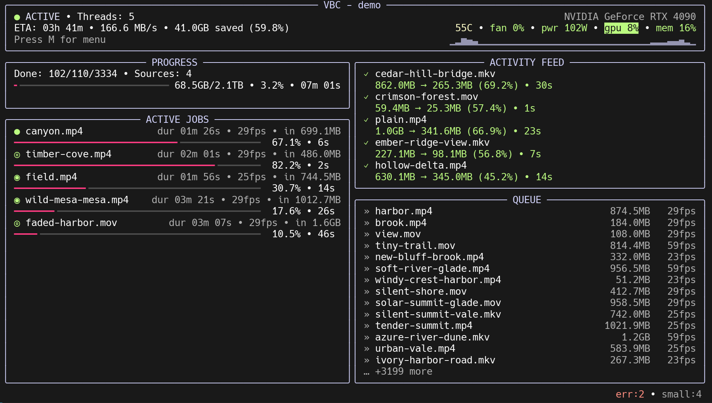

The dashboard provides real-time visibility into:
- **Status Panel**: Files discovered, compression progress, thread count
- **Active Jobs Panel**: Currently processing files with codec, FPS, size, elapsed time
- **Recent Completions**: Last 5 finished jobs with compression ratio
- **Queue Panel**: Next 5 files to process with camera model and size
- **Summary**: Overall stats (success, errors, hardware limits, skipped files)
- **GPU Sparklines** (if enabled): Real-time utilization, memory, temperature, power draw

### Prefs Overlay

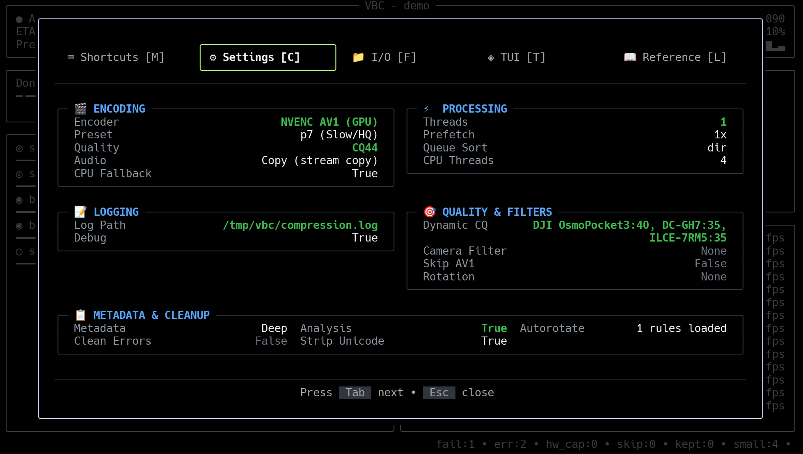

Press `P` to toggle Prefs view showing:
- Input/output directory mappings
- Encoder settings (GPU/CPU, threads, quality)
- Camera-specific quality overrides
- Auto-rotation patterns
- Active filters and thresholds

### Runtime Controls

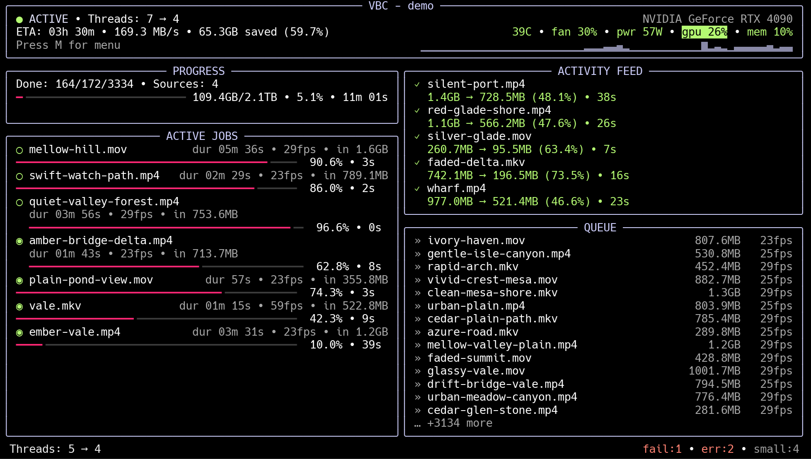

Dynamic thread adjustment while processing:
- Press `.` or `>` to increase threads (instant response)
- Press `,` or `<` to decrease threads
- UI shows immediate feedback: "Threads: 4 → 8"

### Screenshot Gallery

<table>
  <tr>
    <td width="33%"><br/><b>Dashboard</b></td>
    <td width="33%"><br/><b>Prefs [P]</b></td>
    <td width="33%">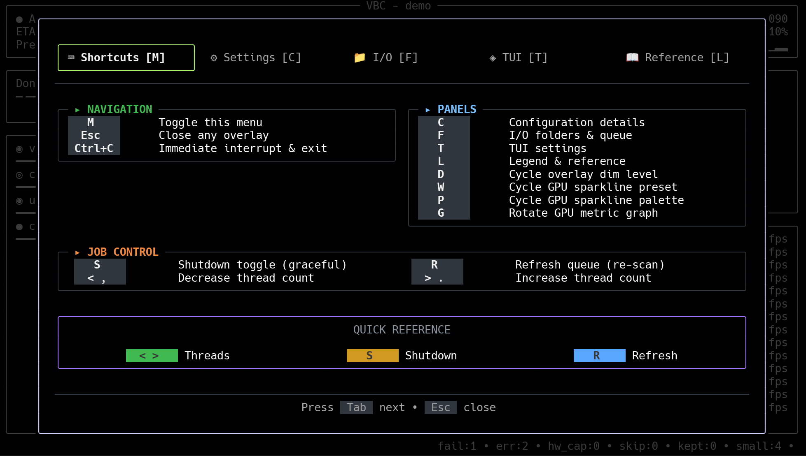<br/><b>Keys [K]</b></td>
  </tr>
  <tr>
    <td>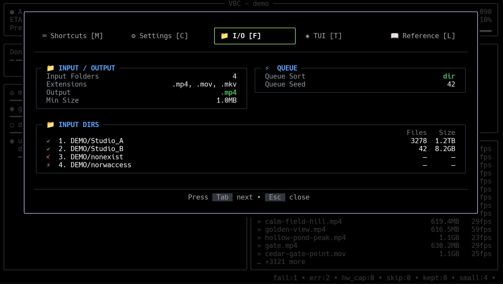<br/><b>I/O Folders [F]</b></td>
    <td>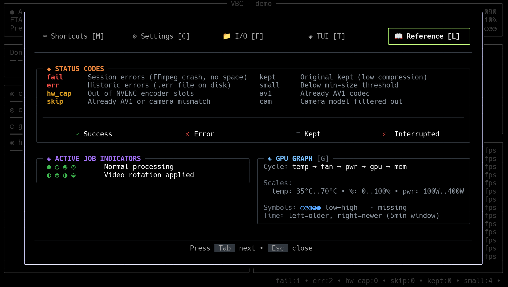<br/><b>Ref [E]</b></td>
    <td>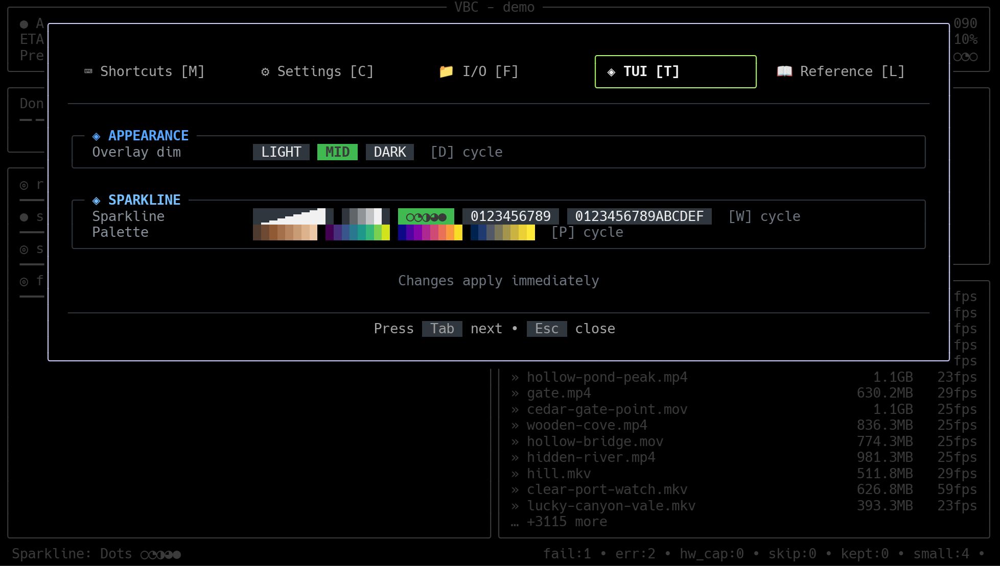<br/><b>TUI Settings [T]</b></td>
  </tr>
  <tr>
    <td><br/><b>Thread Decrease</b></td>
    <td>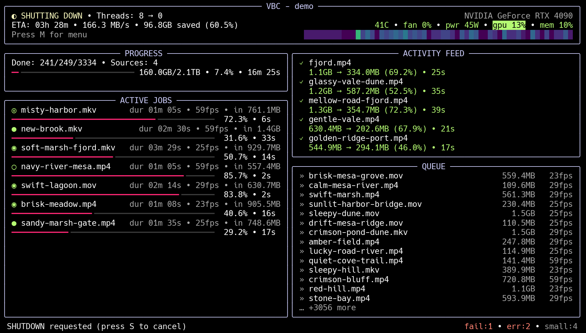<br/><b>Graceful Shutdown [S]</b></td>
    <td>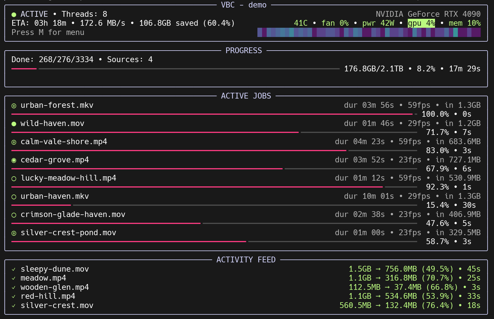<br/><b>Compact Mode</b></td>
  </tr>
</table>

---

## How It Works

### Architecture Overview

VBC follows **Clean Architecture** with strict layer separation and event-driven communication:

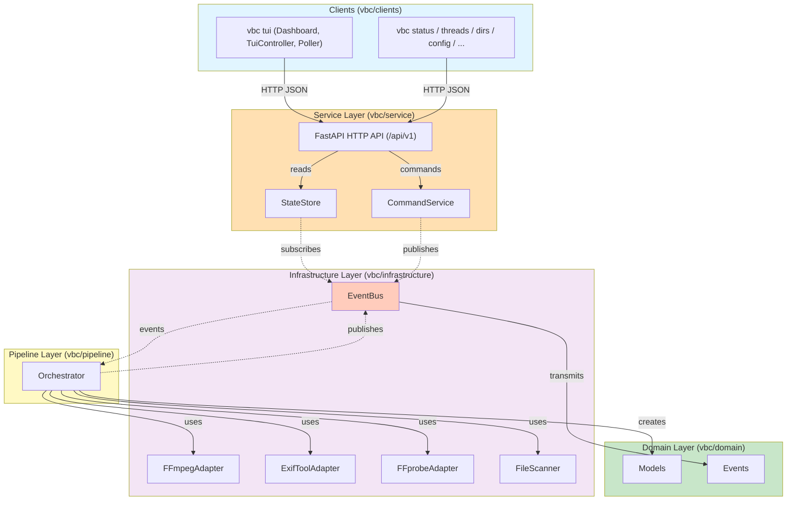

### Core Concepts

**Submit-on-Demand Queue Pattern**
- Only queues `prefetch_factor × threads` jobs (not all 10,000 files)
- Submits new jobs as workers complete
- Memory-efficient for large directories
- Responsive to runtime thread adjustments

**Thread-Safe State Management**
- Condition variables for dynamic concurrency control
- Graceful shutdown coordination (finish active jobs)
- Queue refresh signaling without race conditions

**Event-Driven Architecture**
- EventBus decouples Pipeline from `StateStore`
- Event types defined in `vbc/domain/events.py` plus TUI client events in `vbc/clients/tui/keyboard.py`
- Pydantic events ensure type safety
- Extensible: add new subscribers without modifying publishers

---

## Quick Start

### Prerequisites
- Python 3.12+
- FFmpeg 6.0+ with AV1 support (`av1_nvenc` and/or `libsvtav1`)
- ExifTool (required in current runtime flow)
- `uv` package manager

### First Run

```bash
# Install dependencies
cd /path/to/vbc
uv sync --frozen
# If you intentionally updated dependencies or uv.lock:
# uv sync

# Bootstrap local config (required on first run)
cp conf/vbc.yaml.example conf/vbc.yaml

# Compress a directory: private server + dashboard in one terminal (q quits)
uv run vbc run /path/to/videos
```

### What Happens

1. **Discovery**: Scans `/path/to/videos` for video files (`.mp4`, `.mov`, `.avi`, `.flv`, `.webm`)
2. **Output Created**: Creates `/path/to/videos_out/` directory automatically
3. **Compression**: Starts processing using settings from `conf/vbc.yaml` (defaults apply when fields are omitted)
4. **Dashboard**: Shows real-time progress, active jobs, queue, and summary

### Check Results

```bash
# View compressed files
ls -lh /path/to/videos_out/

# Check logs
cat /tmp/vbc/compression.log

# View metadata tags
exiftool -XMP-vbc:all /path/to/videos_out/compressed_video.mp4
```

**Expected Output Structure**:
```
/path/to/videos/              # Input
├── video1.mp4
├── video2.mov
└── subfolder/
    └── video3.avi

/path/to/videos_out/          # Output (auto-created)
├── video1.mp4                # Compressed to AV1
├── video2.mp4                # Compressed (converted to output format; mp4 by default)
├── subfolder/
│   └── video3.mp4            # Compressed

/path/to/videos_err/          # Errors directory (auto-created from suffix_errors_dirs: "_err")
└── failed_video.err          # Final location of error marker after run
```

---

## Installation

### System Requirements

| Requirement | Version | Purpose |
|-------------|---------|---------|
| **Python** | 3.12+ | Runtime |
| **FFmpeg** | 6.0+ | Video encoding (with `av1_nvenc` or `libsvtav1`) |
| **ExifTool** | Any recent | Metadata extraction and copy (required in current runtime flow) |
| **nvidia-smi** / **nvtop** | - | GPU monitoring panel (NVIDIA GPUs only; `vbc serve` reads `nvidia-smi`, `nvtop` when it is missing) |
| **OS** | Linux, macOS, Windows (WSL) | Platform support |

### Step 1: Install System Dependencies

#### Ubuntu/Debian
```bash
sudo apt update
sudo apt install ffmpeg libimage-exiftool-perl
ffmpeg -codecs | grep av1  # Verify AV1 support
```

#### macOS
```bash
brew install ffmpeg exiftool
ffmpeg -codecs | grep av1
```

#### Arch Linux
```bash
sudo pacman -S ffmpeg perl-image-exiftool
```

### Step 2: Install UV Package Manager

```bash
curl -LsSf https://astral.sh/uv/install.sh | sh
```

### Step 3: Install VBC

```bash
# Clone repository
git clone https://github.com/your-org/vbc.git
cd vbc

# Install dependencies from lockfile (reproducible)
uv sync --frozen
# If you intentionally updated dependencies or uv.lock:
# uv sync

# Bootstrap local runtime config
cp conf/vbc.yaml.example conf/vbc.yaml

# Verify installation
uv run vbc --help
```

### Step 4: GPU Support (Optional)

For NVIDIA GPU acceleration:

```bash
# Verify NVIDIA driver
nvidia-smi

# Verify GPU monitoring tool (for sparklines)
nvtop -s

# Verify NVENC support in FFmpeg
ffmpeg -codecs | grep nvenc
# Should show: av1_nvenc, hevc_nvenc, h264_nvenc
```

**NVENC Session Limits** (important for thread count):
- **RTX 30-series**: ~5 concurrent sessions → max 4-5 threads
- **RTX 40-series** (e.g., RTX 4090): 10-12 sessions (hardware), VBC keyboard runtime control clamps to 1-8
- **Professional GPUs** (Quadro, A-series): Higher/unlimited, VBC keyboard runtime control clamps to 1-8

**10-bit AV1**: Requires RTX 40-series or newer.

### Verification

```bash
# Test with a small directory (settings from conf/vbc.yaml)
uv run vbc run /path/to/test/videos

# Demo mode (no video file processing I/O; logs are still written)
uv run vbc serve --demo     # then, in another terminal: uv run vbc tui
```

Full installation details: [docs/getting-started/installation.md](docs/getting-started/installation.md)

---

## Configuration

### Configuration File

Default: `conf/vbc.yaml`

Create configuration file for persistent settings:

<details>
<summary>📋 Full configuration example (<code>conf/vbc.yaml.example</code>) - Click to expand</summary>

```yaml
# VBC Configuration Example
# All available parameters with descriptions

# --- Input/Output Settings ---

# Ordered list of input directories.
# CLI argument overrides this (no merge).
# UI preserves this exact order.
input_dirs:
  - path: /path/to/videos
    enabled: true
    watch: true
    watch_mode: polling
    poll_interval_seconds: 10
  - path: /path/to/metadata
    enabled: false
    metadata: true
    watch: true
    watch_mode: inotify
  - path: /another/path
    enabled: true
  - path: /disabled/path
    enabled: false

# Explicit output directories (one per enabled input directory, in order).
# Must have the same count as enabled input_dirs entries.
# Cannot be used if suffix_output_dirs is set.
output_dirs: []

# Suffix appended to each input directory name to create output directory.
# Example: /videos -> /videos_out
# Default: "_out"
suffix_output_dirs: "_out"

# Explicit directories for failed files (one per enabled input directory, in order).
# Cannot be used if suffix_errors_dirs is set.
errors_dirs: []

# Suffix appended to each input directory name for failed files.
# After processing, failed source files and their .err markers are moved here.
# Default: "_err"
suffix_errors_dirs: "_err"

# Manifest policy. This is separate from general.copy_metadata.
metadata:
  # fail, ignore, or delete parts without usable video
  audio_only: ignore
  # Maximum missing output video frames accepted for one logical manifest job.
  # Default: 0 (strict).
  max_dropped_frames: 0
  # keep, delete_after_success, move_after_success, or move_all
  # Terminal manifest failures quarantine JSON, .err, and existing inputs
  # together under <source directory>_err/<username>.
  # source_policy: move_all
  # move_after_success_dir: /path/to/source-archive

# --- General Settings ---

general:
  # Max concurrent compression threads (>0, practical cap: executor max_workers=16).
  # Runtime keyboard adjustment (< and >) clamps to 1-8.
  threads: 4

  # Submit-on-demand queue multiplier (>=1).
  # Formula: max_queued = prefetch_factor * threads.
  prefetch_factor: 1

  # Use GPU acceleration (NVENC AV1) if true, otherwise CPU (SVT-AV1).
  gpu: true

  # [DEPRECATED] GPU polling interval in updates per second.
  # Use gpu_config.sample_interval_s instead.
  gpu_refresh_rate: 5

  # Processing order: name, rand, dir, size, size-asc, size-desc, ext,
  # or source-mtime-desc (newest source recording first).
  queue_sort: "name"

  # Optional seed for deterministic random queue sorting.
  queue_seed: null

  # Path to log file. Default: /tmp/vbc/compression.log
  log_path: "/tmp/vbc/compression.log"

  # Retry on CPU if NVENC hits hardware capability error.
  cpu_fallback: false

  # Max CPU threads per FFmpeg worker (null = auto).
  ffmpeg_cpu_threads: null

  # Copy EXIF/XMP/GPS tags from source to output.
  copy_metadata: true

  # keep | delete_after_success. Deletion forces output verification.
  source_policy: keep

  # Use ExifTool for deep metadata analysis (required for dynamic_quality/filtering).
  use_exif: true

  # Only process specific camera models (substring match, case-insensitive).
  # Example: ["ILCE-7RM5", "DJI"]
  filter_cameras: []

  # Camera-specific quality rules (first match wins).
  # Legacy scalar format is not supported:
  #   dynamic_quality: {"Sony": 35}
  dynamic_quality:
    "ILCE-7RM5":
      cq: 38
      rate:
        bps: "0.8"
        minrate: "0.7"
        maxrate: "0.9"
        rate_target_max_bps: "95M"
    "DJI":
      cq: 40
      rate:
        bps: "180M"

  # Optional global hard cap for rate-mode resolved target bitrate.
  # Absolute only (e.g. 95M, 100Mbps, 100000k, 100000000).
  # Note: this caps target bitrate, not instantaneous peak bitrate.
  rate_target_max_bps: null

  # File extensions to scan and process.
  extensions:
    - ".mp4"
    - ".mov"
    - ".avi"
    - ".flv"
    - ".webm"

  # Minimum input file size in bytes to process (Default: 1 MiB).
  min_size_bytes: 1048576

  # Remove existing .err markers on startup and retry those files.
  clean_errors: false

  # Skip files already encoded in AV1 codec.
  skip_av1: false

  # Replace non-ASCII characters with '?' in UI to prevent alignment issues.
  strip_unicode_display: true

  # Global rotation override (null, 0, 90, 180, 270).
  manual_rotation: null

  # Minimum compression savings required (0.0-1.0).
  # If compression < 10%, keep original file instead of compressed version.
  min_compression_ratio: 0.1

  # Attempt repair pass for failed files moved to errors directories.
  # Runs in the TUI after processing and before WAITING/exit.
  auto_repair_errors: true

  # Legacy/special repair setting for corrupted FLV/MP4 stream dumps.
  repair_corrupted_flv: false

  # Enable verbose debug logging.
  debug: false

# --- GPU Monitoring Settings ---

gpu_config:
  # Preferred GPU monitoring config.
  # Takes precedence over legacy general.gpu_refresh_rate.

  # Enable GPU monitoring panel and sparklines.
  enabled: true

  # How often to sample GPU metrics (seconds).
  sample_interval_s: 5.0

  # Total time window shown in sparklines (seconds).
  history_window_s: 300.0

  # Index of the GPU device to monitor.
  nvtop_device_index: 0

  # Optional: specific device name to monitor (overrides index).
  nvtop_device_name: null

# --- GPU Encoder Settings ---

gpu_encoder:
  # Use advanced_args instead of common_args when true.
  advanced: false

  # Base NVENC args (used when advanced=false).
  common_args:
    - "-c:v av1_nvenc"
    - "-preset p7"
    - "-tune hq"
    - "-b:v 0"
    - "-cq 45"
    - "-f mp4"

  # Full NVENC args (used when advanced=true).
  advanced_args:
    - "-c:v av1_nvenc"
    - "-preset p7"
    - "-tune hq"
    - "-b:v 0"
    - "-cq 45"
    - "-rc vbr"
    - "-multipass fullres"
    - "-rc-lookahead 32"
    - "-spatial-aq 1"
    - "-temporal-aq 1"
    - "-aq-strength 8"
    - "-b_ref_mode middle"
    - "-f mp4"

# --- CPU Encoder Settings ---

cpu_encoder:
  # Use advanced_args instead of common_args when true.
  advanced: false

  # Base SVT-AV1 args (used when advanced=false).
  common_args:
    - "-c:v libsvtav1"
    - "-preset 6"
    - "-crf 32"
    - "-svtav1-params tune=0:enable-overlays=1"
    - "-f mp4"

  # Enforce input pix_fmt when advanced=true (adds -pix_fmt from ffprobe).
  advanced_enforce_input_pix_fmt: true

  # Full CPU args (used when advanced=true).
  advanced_args:
    - "-c:v libaom-av1"
    - "-crf 30"
    - "-b:v 0"
    - "-cpu-used 0"
    - "-tune ssim"
    - "-lag-in-frames 35"
    - "-aq-mode 1"
    - "-row-mt 1"
    - "-threads 0"
    - "-f matroska"

# --- UI Settings ---

ui:
  # Max events shown in the activity feed panel (1-20).
  activity_feed_max_items: 5

  # Max concurrent jobs to display in the active panel (1-16).
  active_jobs_max_display: 8

  # Vertical scaling factor for dashboard panels (0.3-1.0).
  panel_height_scale: 0.7

# --- Auto-Rotation Settings ---

autorotate:
  # Regex pattern -> Rotation angle (0, 90, 180, 270).
  # First match wins.
  patterns:
    "GOPR\d+\.MP4": 180
    "IMG_\d{4}\.MOV": 90
```

</details>

### Directory Mapping Modes

**Mode 1: Suffix (Default)**
```yaml
input_dirs:
  - path: /videos
    enabled: true
  - path: /archive
    enabled: false
suffix_output_dirs: _out       # Creates /videos_out
suffix_errors_dirs: _err       # Creates /videos_err
```

**Mode 2: Explicit (1:1 Pairing)**
```yaml
input_dirs:
  - path: /videos
    enabled: true
  - path: /drone_footage
    enabled: true
output_dirs:
  - /compressed/videos
  - /compressed/drone
suffix_output_dirs: null       # Disable suffix mode
```

**Folders on the command line**:
```bash
# DIRS replace the config's input_dirs for this run only (no merge, never saved)
uv run vbc run /custom/path
```

Full configuration reference: [docs/getting-started/configuration.md](docs/getting-started/configuration.md)

---

## Usage

### Basic Commands

```bash
# Compress a folder with the settings from conf/vbc.yaml (private server + dashboard)
uv run vbc run /path/to/videos

# Same with another config file (e.g. a copy tuned for archive quality)
uv run vbc run /path/to/videos --config conf/production.yaml

# The folders listed in the config
uv run vbc run

# Long-running server and clients
uv run vbc serve
uv run vbc tui
uv run vbc status
```

`vbc run [DIRS] [--config FILE]` has no per-run settings: threads, GPU/CPU,
quality, camera filter, rotation, error cleanup, debug and the rest live in the
config file or in a folder's `VBC.YAML` (threads also change live with `<` /
`>`). Folders given as `DIRS` replace the config's list for that run only.

**Configuration precedence**: local `VBC.YAML` overrides > global YAML (`conf/vbc.yaml`) > defaults

Full CLI reference, including where each former `vbc run` option went: [docs/user-guide/cli.md](docs/user-guide/cli.md)

### Runtime Controls

While VBC is running (`vbc tui` or `vbc run`), use these keyboard shortcuts:

| Key | Action | Description |
|-----|--------|-------------|
| `<` or `,` | Decrease threads | Reduce max concurrent threads by 1 (min: 1) |
| `>` or `.` | Increase threads | Increase max concurrent threads by 1 (max: `max_threads`, default 8) |
| `S` or `s` | Graceful stop | Stop accepting new jobs, finish active ones (press `S` again while stopping to cancel; `R` once stopped to resume) |
| `R` or `r` | Refresh queue | Re-scan directory and add new files (resumes stopped/paused server) |
| `Q` / `Ctrl+Q` / `Ctrl+C` | Quit | `vbc tui`: exit at once, the server keeps running; `vbc run`: exit and stop the private server (running jobs are interrupted) |
| `Shift+U` | Unlock keyboard | Unlock `vbc tui` keyboard after 60s idle auto-lock |
| `P` or `p` | Overlay: Prefs | Open/close Prefs tab |
| `F` or `f` | Overlay: I/O | Open/close I/O tab |
| `D` or `d` | Overlay: Dirs | Open/close Dirs tab (interactive input folders editor) |
| `K` or `M` | Overlay: Keys | Open/close Keys tab |
| `T` or `t` | Overlay: TUI | Open/close TUI appearance tab |
| `E` or `e` | Overlay: Ref | Open/close Ref tab |
| `L` or `l` | Overlay: Logs | Open/close logs tab (session errors) |
| `[` / `]` | Logs pagination | Previous / next page in Logs tab |
| `Tab` | Cycle overlay tabs | Move to next tab |
| `Esc` | Close overlay | Close active overlay tab |

**Thread Adjustment**: Changes take effect instantly. New jobs start as slots become available.

**Graceful Stop / Shutdown**: Press `S` to stop the queue and let active jobs finish. Press `S` again while stopping to cancel, or `R` once stopped to resume processing.

**Queue Refresh**: Press `R` to re-scan input directories. New files are added to the queue without duplicating existing ones.

Full runtime controls guide: [docs/user-guide/runtime-controls.md](docs/user-guide/runtime-controls.md)

---

## Architecture

### Clean Architecture Layers

```
┌─────────────────────────────────────────────────┐
│              Clients (vbc/clients/)             │
│  vbc tui (Rich Dashboard), One-Shot CLI         │
└────────────────────────┬────────────────────────┘
                         │ HTTP JSON API (/api/v1)
┌────────────────────────┴────────────────────────┐
│            Service Layer (vbc/service/)         │
│  StateStore (read model), CommandService, API   │
└────────────────────────┬────────────────────────┘
                         │ Events (Pub/Sub via EventBus)
┌────────────────────────┴────────────────────────┐
│              Pipeline Layer                     │
│  Orchestrator (job lifecycle, queue, threads)   │
└────────────────────────┬────────────────────────┘
                         │ Domain Models (VideoFile, Job)
┌────────────────────────┴────────────────────────┐
│          Infrastructure Layer                   │
│  FFmpeg, ExifTool, FFprobe, FileScanner         │
│  (External tool adapters & watchers)            │
└─────────────────────────────────────────────────┘
```

**Benefits**:
- **Separation of concerns**: Headless server (`vbc serve`) runs independently of presentation clients (`vbc tui`, CLI)
- **Maintainability**: Change UI or add clients without touching pipeline logic
- **Extensibility**: Add new event subscribers without modifying publishers

### Job Lifecycle

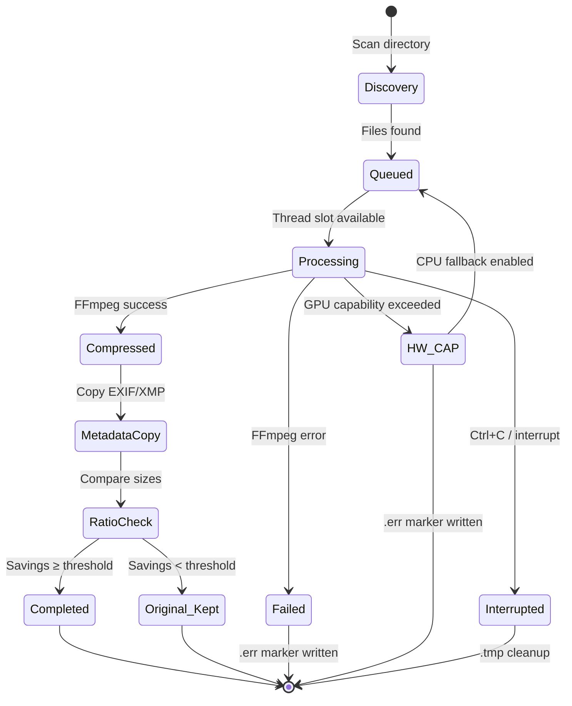

### Event Flow

All server components communicate via **EventBus** (synchronous pub/sub):

**Discovery Phase**:
```
Orchestrator → DiscoveryStarted → StateStore → Update run_status
Orchestrator → DiscoveryFinished → StateStore → Update file counts & rev
```

**Job Processing**:
```
Orchestrator → JobStarted → StateStore → Add to active jobs snapshot
Orchestrator → JobCompleted → StateStore → Update stats, move to recent
Orchestrator → JobFailed → StateStore → Increment error counter & log
```

**Client / User Control**:
```
Client PUT /threads → CommandService → SetThreadCount → Orchestrator → ThreadCountChanged
Client POST /stop   → CommandService → SetShutdownRequested(True) → Orchestrator → Graceful stop
Client POST /refresh → CommandService → RefreshRequested → Orchestrator → Re-scan directory
```

Architecture deep dive: [docs/architecture/overview.md](docs/architecture/overview.md)

---

## Advanced Features

### Dynamic Quality (Camera-Specific Quality)

Apply different quality settings per camera model:

```yaml
gpu_encoder:
  common_args:
    - "-cq 45"  # Default for unknown cameras

general:
  dynamic_quality:
    "ILCE-7RM5":
      cq: 38            # CQ mode override
      rate:             # Optional rate mode override
        bps: "0.8"
        minrate: "0.7"
        maxrate: "0.9"
        rate_target_max_bps: "95M"
    "DC-GH7":
      cq: 40
    "DJI OsmoPocket3":
      cq: 48
      rate:
        bps: "180M"
```

**How it works**:
1. VBC extracts full EXIF metadata via ExifTool
2. Searches all metadata fields for camera model strings
3. First match wins (order matters in YAML)
4. Uses `cq` in `quality_mode=cq`, or `rate` when `quality_mode=rate` (if present)

`rate_target_max_bps` can be set globally (`general.rate_target_max_bps`) or per camera
(`general.dynamic_quality.<pattern>.rate.rate_target_max_bps`) to hard-cap resolved rate targets.
For `libsvtav1`, VBC also enforces encoder-safe limits and records applied decisions in `XMP:VBCJsonNotes`.

**Example**:
- File: `IMG_1234.MOV`
- EXIF: `Model = "ILCE-7RM5"`
- Result: Uses CQ 38 instead of default 45

### Auto-Rotation

Automatically rotate videos based on filename patterns:

```yaml
autorotate:
  patterns:
    "DJI_.*\\.MP4": 0          # DJI drones - no rotation needed
    "GOPR\\d+\\.MP4": 180      # GoPro - flip upside down
    "IMG_\\d{4}\\.MOV": 90     # iPhone - rotate 90° clockwise
```

**Rotation Angles**:
- `0` = No rotation
- `90` = Clockwise (transpose=1)
- `180` = Upside down (`transpose=2,transpose=2`)
- `270` = Counter-clockwise (transpose=2)

**Manual Override** (overrides all patterns; in the config or a folder's `VBC.YAML`):
```yaml
general:
  manual_rotation: 180
```

### Camera Filtering

Process only files from specific cameras:

```yaml
general:
  filter_cameras:
    - "ILCE-7RM5"
    - "DJI OsmoPocket3"
    - "Canon EOS R5"
```

The same key works in a folder's `VBC.YAML`.

**Matching**: Substring match (case-insensitive). Example:
- Filter: `["ILCE-7RM5"]`
- File camera: `ILCE-7RM5`
- Match: ✓ (`"ILCE-7RM5"` appears in camera model)

### Minimum Compression Ratio

Keep original file if compression savings are insufficient:

```yaml
general:
  min_compression_ratio: 0.1  # Require 10% savings
```

**Example**:
```
Input:  100 MB
Output:  92 MB
Savings: 8% (1 - 92/100 = 0.08)
Result:  8% < 10% → Keep original (copy 100 MB file to output)
```

**Use case**: Prevent "compression" that makes files larger or provides negligible savings.

### Hardware Capability Detection

VBC automatically detects and handles GPU limitations:

**Error Detection**:
- FFmpeg outputs: `"Hardware is lacking required capabilities"`
- Or exits with code 187
- VBC sets job status to `HW_CAP_LIMIT`, creates `.err` marker

**Common Causes**:
1. **Session limits exceeded**: Too many concurrent threads for GPU
2. **10-bit encoding unavailable**: Older GPUs lack 10-bit AV1 support

**Workarounds** (in `conf/vbc.yaml`, or a folder's `VBC.YAML` for `gpu` / `cpu_fallback`):
```yaml
general:
  threads: 5           # GPU session limit, e.g. RTX 30-series (live: < / > or `vbc threads 5`)
  cpu_fallback: true   # automatic retry on CPU
  # gpu: false         # or pure CPU mode
```

### Color Space Fix (FFmpeg 7.x)

FFmpeg 7.x rejects "reserved" color space values. VBC automatically fixes this:

1. **Detects** `color_space=reserved` via FFprobe
2. **Remuxes** with bitstream filter to set valid color space
3. **Compresses** using fixed file
4. **Cleans up** temporary remuxed file

Supported codecs: HEVC (h265), H.264. Transparent to user.

Full advanced features guide: [docs/user-guide/advanced.md](docs/user-guide/advanced.md)

---

## Demo Mode

Test VBC without processing real files:

```bash
# Demo server with defaults, then the dashboard in another terminal
uv run vbc serve --demo
uv run vbc tui

# Custom demo config
uv run vbc serve --demo --demo-config conf/demo.yaml
```

**Demo configuration** (`conf/demo.yaml`):
```yaml
# Minimal override example (full schema: conf/demo.yaml)
seed: 1337
files:
  count: 50
sizes:
  distribution: triangular
  min_mb: 20
  mode_mb: 180
  max_mb: 1800
errors:
  total: 3
```

**UI shows**: `VBC - demo` title and synthetic filenames. Full event flow matches real runs.

---

## Troubleshooting

### Common Issues

#### GPU Hardware Capability Errors

**Symptom**: Jobs fail with `HW_CAP_LIMIT` status

**Causes**:
1. Too many concurrent threads for GPU session limit
2. 10-bit AV1 encoding not supported by GPU

**Solutions** (in `conf/vbc.yaml`):
```yaml
general:
  threads: 5           # GPU limit: 5 on RTX 30-series, 8 on RTX 4090
  cpu_fallback: true   # retry failed GPU jobs on CPU
  # gpu: false         # switch to CPU mode entirely
```

#### Color Space Errors

**Symptom**: FFmpeg fails with color space warnings

**Solution**: VBC automatically applies color space fix. Enable debug logging to verify:
Set `general.debug: true` (or run `vbc log-level DEBUG` against a running server) and
look for `FFMPEG_COLORFIX` or `Successfully fixed color space` in the log.

#### Automatic Repair of Failed Files

**Symptom**: Failed files are moved to `*_err` and remain unreadable

**Solution**: VBC runs one automatic repair pass by default after the queue becomes empty:
```yaml
general:
  auto_repair_errors: true
```

**Behavior**:
1. After normal processing, VBC shows **REPAIR** in the TUI.
2. VBC moves `.err` files created in the current session and their source files to error directories.
3. VBC attempts repair once per source file for the current session.
4. Successfully repaired files are restored to source folders, usually as `.mkv`.
5. On normal completion, restored files are queued and compressed immediately, even if `.mkv` is not in `general.extensions`.
6. If repair was reached after graceful shutdown (`S`), VBC repairs once and then exits without compressing restored files.

#### Files Not Being Processed

**Causes**:
1. Already compressed (output exists and is newer than input)
2. Below `min_size_bytes` threshold
3. Has `.err` marker (unless `general.clean_errors`)
4. Already AV1-encoded (if `general.skip_av1` is enabled)
5. Camera model doesn't match `filter_cameras`

**Solution**: Check discovery counters in UI:
```
Files found: 100 | To process: 50 | Already compressed: 30 | Ignored: size:15, err:5
```

#### Thread Count Not Changing

**Symptom**: Press `.` but threads don't increase

**Causes**:
1. Already at max (8 threads)
2. Graceful shutdown active (`S` pressed)

**Solution**: Check UI for "SHUTDOWN requested" message. Press `S` again to cancel shutdown.

#### Accidental Shutdown

**Symptom**: Pressed `S` by mistake, want to continue

**Solution**: Press `S` again immediately to cancel shutdown:
```
Press: S
UI: "SHUTDOWN requested (press S to cancel)"
Active: 4 jobs continue | Queue: 50 jobs frozen

Press: S (again)
UI: "SHUTDOWN cancelled"
Queue: Resumes processing
```

### Logs

Check detailed logs:
```bash
cat /tmp/vbc/compression.log

# Or custom path
cat /path/to/custom.log

# Fatal uncaught exceptions (startup/runtime)
cat error.log

# Live tail
tail -f /tmp/vbc/compression.log

# Error markers moved after run
find /path/to/videos_err -name "*.err"
```

---

## Development

### Project Structure

```
vbc/                         # CLI entry point: cli.py
├── service/                 # Headless server (`vbc serve`): read model, commands, HTTP API
├── clients/                 # `vbc tui`, `vbc run` launcher, one-shot commands (HTTP only)
├── contracts/               # API DTOs shared by server and clients
├── config/                  # Configuration (Pydantic models + YAML loader)
├── domain/                  # Core business logic (models, events)
├── infrastructure/          # External adapters (FFmpeg, ExifTool, EventBus)
├── pipeline/                # Processing coordination (Orchestrator)
└── maintenance/             # Manifest restore / repair
scripts/                     # Stand-alone helpers and release tooling

docs/                        # MkDocs documentation
├── getting-started/         # Installation, quickstart, configuration
├── user-guide/              # CLI, runtime controls, advanced features
├── architecture/            # Overview, events, pipeline flow, service split plan
└── development/             # Contributing, testing

tests/e2e/                   # End-to-end suite (added during the service split)
```

The codebase is split into a headless server (`vbc serve`) and clients
(`vbc tui`, one-shot API commands); see
[docs/architecture/service-split.md](docs/architecture/service-split.md).
`vbc run [DIRS] [--config FILE]` starts a private server on loopback with the dashboard in one terminal.
The headless server runs as `vbc serve --config conf/vbc.yaml`
(HTTP API on `127.0.0.1:8770` by default, OpenAPI in `docs/api/openapi.json`), driven
by one-shot commands: `vbc status [--watch]`, `vbc threads N`, `vbc refresh`,
`vbc stop [--interrupt|--cancel]`, `vbc dirs [add|remove|enable|disable|set|scan]`,
`vbc errors`, `vbc logs [--follow]`, `vbc config [--push|get|set|unset]`, `vbc versions`,
`vbc log-level LEVEL`, `vbc sources cleanup`, `vbc manifests [restore|repair]`
(`--api URL` or `VBC_API`, `--json`), and by the terminal UI `vbc tui`
(the dashboard `vbc run` also shows; `S` gracefully stops/cancels processing, while `Q`,
Ctrl+Q or Ctrl+C quit the client and leave the server running).
See [docs/user-guide/server.md](docs/user-guide/server.md).

### Running Tests

VBC has no unit tests by design; behaviour is covered by a small black-box
end-to-end suite (see the testing guide below).

```bash
uv sync --extra dev
uv run pytest            # runs tests/e2e
```

### Documentation

Build and serve docs locally:

```bash
# Install docs dependencies
uv sync --extra docs

# Serve documentation
./scripts/serve-docs.sh
# Or: uv run mkdocs serve

# Open browser: http://127.0.0.1:8000
```

### Code Quality

```bash
# Optional quality tools (not pinned in `pyproject.toml` by default):
#   uv add --group dev ruff black mypy
# Then run:
uv run ruff check vbc/
uv run black vbc/
uv run mypy vbc/
```

Testing guide: [docs/development/testing.md](docs/development/testing.md)

---

## Contributing

We welcome contributions! VBC follows clean architecture principles and event-driven design.

### Quick Start for Contributors

```bash
# Clone repository
git clone git@github.com:your-org/vbc.git
cd vbc

# Install dependencies
uv sync

# Run tests
uv run pytest

# Make changes
git checkout -b feature/my-feature

# Commit (use conventional commits)
git commit -m "feat: add support for H.265 encoding"

# Push and create PR
git push origin feature/my-feature
```

### Coding Standards

- **Python Style**: PEP 8 with 120-character line length
- **Type Hints**: Required for all public functions
- **Docstrings**: Google-style for public classes/methods
- **Dependency Injection**: No global state, inject via constructors
- **Event-Driven**: Use EventBus for cross-component communication
- **Pydantic Models**: All config and data validation via Pydantic

### Commit Message Format

```bash
feat: add new feature
fix: fix bug
docs: update documentation
test: add tests
refactor: refactor code
chore: update dependencies
```

Full contributing guide: [docs/development/contributing.md](docs/development/contributing.md)

---

## License

MIT License (see LICENSE)

---

The HomeStack container packages only the headless server, using the locked
`server` dependency group from `pyproject.toml`. The local TUI and CLI clients
are excluded from the image, together with their Rich/Typer/Jinja2 libraries.
Client-only changes do not require a server image release. See
[the container runtime contract](deploy/container/README.md).

## Acknowledgements

VBC is built with excellent open-source tools:

- [FFmpeg](https://ffmpeg.org/) - Video processing engine
- [Rich](https://github.com/Textualize/rich) - Terminal UI framework
- [Pydantic](https://docs.pydantic.dev/) - Data validation
- [Typer](https://typer.tiangolo.com/) - CLI framework
- [PyExifTool](https://github.com/sylikc/pyexiftool) - ExifTool Python wrapper
- [inotify-simple](https://github.com/chrisjbillington/inotify_simple) - Linux manifest-directory events
- [FastAPI](https://fastapi.tiangolo.com/) + [uvicorn](https://www.uvicorn.org/) - HTTP API of `vbc serve`
- [HTTPX](https://www.python-httpx.org/) - HTTP client (server heartbeat, client commands)
- [uv](https://github.com/astral-sh/uv) - Fast Python package manager

---

## Links

- **Documentation**: [docs/](docs/)
- **Issue Tracker**: https://github.com/your-org/vbc/issues
- **Discussions**: https://github.com/your-org/vbc/discussions
- **Documentation Changelog**: [docs/DOCUMENTATION_CHANGELOG.md](docs/DOCUMENTATION_CHANGELOG.md)

---

**Quick Links**:
- [Installation Guide](docs/getting-started/installation.md)
- [Quick Start](docs/getting-started/quickstart.md)
- [Configuration Reference](docs/getting-started/configuration.md)
- [CLI Reference](docs/user-guide/cli.md)
- [Architecture Overview](docs/architecture/overview.md)
- [Contributing Guide](docs/development/contributing.md)
