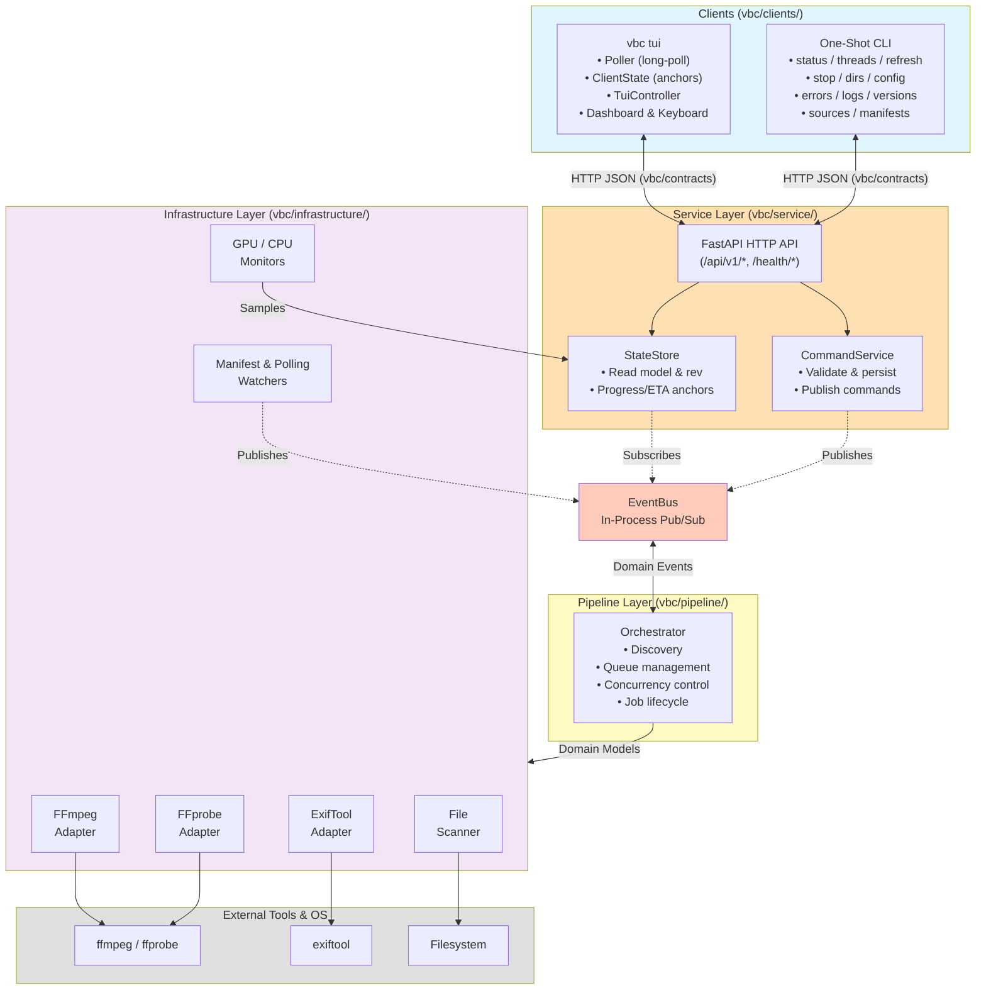

# Architecture Overview

VBC follows **Clean Architecture** principles with clear separation of concerns, dependency injection, and event-driven communication.

## Design Principles

1. **Dependency Inversion**: High-level modules don't depend on low-level modules. Both depend on abstractions (events, interfaces).
2. **Single Responsibility**: Each class has one reason to change.
3. **Event-Driven**: Components communicate via `EventBus` for loose coupling.
4. **Testability**: Dependency injection enables easy mocking and unit testing.
5. **Type Safety**: Pydantic models ensure configuration and data validation.

## Layer Architecture

VBC separates the **headless server** (`vbc serve`, owning all business state and file operations) from **clients** (`vbc tui` and one-shot CLI commands, owning only presentation state and communicating via HTTP JSON DTOs in `vbc/contracts/`). During the migration, `vbc run <dirs>` runs the frozen in-process dashboard from `vbc_legacy/`.



## Directory Structure

```
vbc/
├── __init__.py
├── cli.py                   # Peer CLI subcommands (serve, tui, status, ..., run)
├── version.py               # Runtime version resolution
│
├── contracts/               # Transport-only Pydantic DTOs shared by server and clients
│   └── __init__.py
│
├── config/                  # Configuration layer
│   ├── loader.py            # YAML loading logic
│   ├── models.py            # Pydantic config models (AppConfig, GeneralConfig, ServerConfig, ...)
│   ├── overrides.py         # CLI override helpers
│   ├── rate_control.py      # Rate control validation
│   ├── local_registry.py    # Per-folder VBC.YAML discovery
│   └── input_dirs.py        # Input/output/error directory evaluation
│
├── domain/                  # Core business logic (framework-agnostic)
│   ├── models.py            # VideoFile, CompressionJob, VideoMetadata, CompressionManifest
│   └── events.py            # Domain event definitions
│
├── infrastructure/          # External adapters (replaceable)
│   ├── event_bus.py         # Synchronous in-process Pub/Sub event system
│   ├── logging.py           # Logging configuration
│   ├── file_scanner.py      # Recursive directory scanner
│   ├── exif_tool.py         # ExifTool wrapper
│   ├── ffprobe.py           # FFprobe wrapper
│   ├── ffmpeg.py            # FFmpeg compression wrapper
│   ├── manifest_watcher.py  # Linux inotify watcher for JSON manifests
│   ├── polling_watcher.py   # Polling watcher for NFS/video directories
│   ├── gpu_monitor.py       # NVIDIA GPU sampler (nvidia-smi / nvtop)
│   ├── cpu_monitor.py       # CPU utilization sampler (when GPU encoding is off)
│   └── housekeeping.py      # Cleanup service
│
├── pipeline/                # Processing coordination
│   ├── orchestrator.py      # Main orchestrator
│   ├── demo_orchestrator.py # Simulation-mode orchestrator (--demo)
│   ├── queue_sorting.py     # Queue ordering strategies
│   ├── error_file_mover.py  # Quarantine failed files and .err markers
│   ├── output_timestamps.py # Output mtime preservation
│   └── repair.py            # Automatic session repair pass
│
├── maintenance/             # Server-side manifest restore and repair
│   ├── restore.py           # Restore failed manifests and archived sources
│   └── repair.py            # Controlled recompression for supported manifest failures
│
├── service/                 # Headless server (`vbc serve`)
│   ├── __main__.py          # Container / `python -m vbc.service` entry point
│   ├── bootstrap.py         # VbcServer composition root & lifecycle
│   ├── state_store.py       # Read model, rev counter, dead-reckoning anchors
│   ├── commands.py          # CommandService (validation, config persistence, events)
│   ├── api.py               # FastAPI + uvicorn HTTP app, health & telemetry
│   ├── storage.py           # Storage roots & media mount discovery
│   ├── log_buffer.py        # In-memory application log ring buffer
│   ├── versions.py          # Runtime tool/driver/package version collector
│   ├── source_cleanup.py    # Background verified-source duplicate cleaner
│   └── manifest_tasks.py    # Restore/repair task runner for the API
│
└── clients/                 # API clients (never import server internals)
    ├── api_client.py        # httpx client (long-poll, clock-skew offset, error mapping)
    ├── commands.py          # One-shot CLI command implementations
    ├── format.py            # Human-readable CLI formatters
    └── tui/                 # `vbc tui`: Rich dashboard fed by the HTTP API
        ├── app.py           # TUI entry point
        ├── state.py         # ClientState (API snapshots + dead-reckoning + view state)
        ├── poller.py        # Background long-poll & resource sync thread
        ├── controller.py    # TuiController (view events & async API commands)
        ├── keyboard.py      # Raw terminal keyboard listener (with auto-lock & paste guard)
        ├── dashboard.py     # Rich Live dashboard layout
        ├── modern_overlays.py # Tabbed overlays (Keys, Prefs, I/O, Dirs, TUI, Ref, Logs)
        ├── panels.py        # Border-joined Rich panels
        └── gpu_sparkline.py # Sparkline presets, palettes, and renderers
```

## Component Responsibilities

### Config Layer

**Purpose**: Load and validate configuration from YAML + environment/CLI overrides.

- `models.py`: Pydantic models with validation rules
- `loader.py`: YAML parsing and CLI merging logic

**Key Models**:
- `AppConfig`: Root configuration
  - `GeneralConfig`: Core settings (threads, `max_threads`, `stability_check_s`, CQ/rate, GPU, etc.)
  - `ServerConfig`: HTTP API bind host, port, `allowed_hosts`, `stop_timeout_s`
  - `StorageConfig`: Allowed `roots` and `discovered` media mounts
  - `MetadataConfig`: Manifest job policies
  - `AutoRotateConfig`: Sidecar and regex rotation patterns

### Domain Layer

**Purpose**: Business entities and rules (no external dependencies).

- `models.py`: Core data structures
  - `VideoFile`: Input file or manifest task with `job_id` and metadata
  - `VideoMetadata`: Codec, resolution, camera, etc.
  - `CompressionJob`: Job state and results
  - `JobStatus`: Enum (`PENDING`, `PREFLIGHT`, `PROCESSING`, `COMPLETED`, `FAILED`, `HW_CAP_LIMIT`, `SKIPPED`, `INTERRUPTED`)

- `events.py`: Domain events
  - `JobStarted`, `JobProgressUpdated`, `JobCompleted`, `JobFailed`
  - `DiscoveryStarted`, `DiscoveryFinished`
  - `HardwareCapabilityExceeded`, `QueueUpdated`, `RefreshFinished`
  - `SetThreadCount`, `ThreadCountChanged`, `SetShutdownRequested`, `InterruptRequested`
  - `RefreshRequested`, `InputDirsChanged`, `ActionMessage`
  - `ProcessingFinished`, `RepairStarted`, `RepairFinished`, `ProcessingPausedOnError`, `WaitingForInput`

### Infrastructure Layer

**Purpose**: Interact with external systems (files, processes, libraries).

#### EventBus
- Synchronous Pub/Sub pattern (`subscribe`, `unsubscribe`, `publish`)
- Type-safe event subscriptions
- Decouples components inside the server

#### FileScanner
- Recursive directory traversal
- Extension and size filtering
- Yields `VideoFile` objects

#### ExifToolAdapter
- Wraps `pyexiftool` library
- Extracts camera model, GPS, metadata, and VBC XMP tags
- Enables dynamic quality matching
- Thread-safe (uses lock)

#### FFprobeAdapter
- Wraps `ffprobe` binary
- Extracts stream info (codec, resolution, FPS, color space, packet counts)
- Faster than ExifTool for video streams

#### FFmpegAdapter
- Wraps `ffmpeg` binary
- Builds command-line arguments (GPU/CPU, rotation, filters, concat groups)
- Monitors progress via stdout parsing
- Detects hardware capability errors
- Handles color space remuxing

#### Watchers & Monitors
- `ManifestWatcher`: Linux `inotify` watcher for incremental `.json` manifest discovery
- `PollingWatcher`: Periodic directory scanner for NFS-mounted video or manifest folders
- `GpuMonitor` / `CpuMonitor`: Background metric samplers feeding `StateStore` (`nvidia-smi` with `nvtop` fallback on GPU; `/proc/stat` on CPU)

#### HousekeepingService
- Cleanup `.tmp` files
- Cleanup `.err` markers (conditional)

### Pipeline Layer

**Purpose**: Orchestrate the compression workflow.

#### Orchestrator
- **Discovery**: Scan input directories, check file stability (`stability_check_s`), filter already-compressed files
- **Metadata caching**: Thread-safe cache to avoid redundant ExifTool/FFprobe calls
- **Decision logic**:
  - Determine quality (CQ or bitrate target, default or camera-specific, local `VBC.YAML` overrides)
  - Determine rotation (manual override, `.rot` sidecar, or regex pattern)
  - Check color space and fix if needed
- **Submit-on-demand**: Queue management with prefetch factor
- **Concurrency control**: Dynamic thread adjustment (`SetThreadCount` clamped to `1..max(max_threads, threads)`)
- **Job lifecycle**: Submit → Preflight → Process → Verify → Complete/Fail
- **Event emission**: Publish domain events to `EventBus`
- **Graceful stop / shutdown**: Finish active jobs on `SetShutdownRequested(True)`, resume after stop via `reset_after_stop()`
- **Refresh**: Re-scan all or specific watched directories and merge new files into the queue

### Service Layer (`vbc serve`)

**Purpose**: Expose a versioned read model and idempotent command plane over HTTP.

#### StateStore
- Subscribes to domain events on the server's `EventBus`
- Maintains the thread-safe business read model (counters, active jobs, recent jobs, queue, session errors, GPU/CPU samples)
- Computes throughput and progress rate EWMAs and publishes dead-reckoning anchors (`rev` bumps only when client extrapolation would drift by >2 percentage points or on discrete state transitions)

#### CommandService
- Validates client commands (`set_threads`, `refresh`, `stop`, `cancel_stop`, `put_dirs` with `If-Match` and storage root checks, `scan_mounts`, `push_config`, `patch_config` with optimistic old-value checks)
- Persists configuration atomically and publishes domain events (`SetThreadCount`, `SetShutdownRequested`, `InterruptRequested`, `InputDirsChanged`, `RefreshRequested`)

#### HTTP API (`service/api.py`)
- FastAPI + uvicorn server
- Long-polling on `/api/v1/state` and `/api/v1/logs` via `asyncio.Event`
- Host/Origin allowlist guard and client session tracking (`ClientRegistry`)
- HomeStack health (`/health/live`, `/health/ready`) and telemetry (`/.well-known/homestack/status`)

### Clients Layer (`vbc tui` & CLI)

**Purpose**: Present server state and send user commands without importing server internals.

#### ClientState & Poller (`vbc/clients/tui/`)
- `Poller`: Long-polls `/api/v1/state` in a background thread and refetches `/queue`, `/errors`, `/dirs`, `/io`, `/config`, and `/gpu` when revisions change
- `ClientState`: Combines server DTO snapshots with local view state (active overlay tab, Dirs cursor/staged edits, sparkline settings) and extrapolates active job progress and ETA locally between snapshots

#### TuiController & KeyboardListener (`vbc/clients/tui/`)
- `KeyboardListener`: Reads terminal keys in cbreak mode, handles auto-lock (`Shift+U` after 60 s idle) and bracketed paste protection, and publishes client-local UI events
- `TuiController`: Updates `ClientState` for view actions and dispatches server commands (`PUT /threads`, `POST /refresh`, `POST/DELETE /stop`, `PUT /dirs`, `POST /dirs/scan`) asynchronously via `ApiClient`

#### Dashboard (`vbc/clients/tui/dashboard.py`)
- Full-screen Rich Live layout with border-joined panels (`vbc/clients/tui/panels.py`), status header, GPU/CPU sparklines, progress & ETA, active jobs, activity feed, queue, and tabbed overlays (`Keys`, `Prefs`, `I/O`, `Dirs`, `TUI`, `Ref`, `Logs`)

## Data Flow

### Compression Job Lifecycle

```
1. Discovery Phase
   ┌────────────────┐
   │ Orchestrator   │
   │ .run()         │
   └───────┬────────┘
           │ scan directory
           ▼
   ┌────────────────┐
   │  FileScanner   │ → yields VideoFile objects
   └───────┬────────┘
           │ emit DiscoveryFinished
           ▼
   ┌────────────────┐
   │   EventBus     │ → StateStore updates read model (bumps rev)
   └────────────────┘

2. Job Submission Phase
   ┌────────────────┐
   │ Orchestrator   │
   │ submit_batch() │
   └───────┬────────┘
           │ create CompressionJob
           ▼
   ┌────────────────┐
   │ThreadPoolExecutor│ → _process_file(video_file)
   └────────────────┘

3. Processing Phase
   ┌────────────────┐
   │ _process_file()│
   └───────┬────────┘
           │ 1. Check .err markers & stability
           │ 2. ffprobe (stream info)
           │ 3. Color space fix
           │ 4. Get metadata (ExifTool)
           │ 5. Filter (AV1/camera)
           │ 6. Determine CQ/rate & rotation
           │ 7. Emit JobStarted
           ▼
   ┌────────────────┐
   │ FFmpegAdapter  │
   │ .compress()    │
   └───────┬────────┘
           │ ffmpeg subprocess
           │ monitor progress (JobProgressUpdated)
           │ detect errors
           ▼
   ┌────────────────┐
   │Job Status Set  │
   │COMPLETED/FAILED│
   └───────┬────────┘
           │ 8. Copy metadata (ExifTool)
           │ 9. Check min ratio & verify output
           │ 10. Emit JobCompleted/JobFailed
           ▼
   ┌────────────────┐
   │   EventBus     │ → StateStore updates read model (bumps rev)
   └────────────────┘
```

## Concurrency Model

### ThreadController Pattern

VBC uses a **condition variable** for dynamic concurrency control:

```python
# Orchestrator._thread_lock (Condition)
with self._thread_lock:
    while self._active_threads >= self._current_max_threads:
        self._thread_lock.wait()  # Block until slot available

    if self._shutdown_requested:
        return

    self._active_threads += 1

# Process job...

with self._thread_lock:
    self._active_threads -= 1
    self._thread_lock.notify_all()  # Wake up waiting threads
```

**Benefits**:
- No polling, efficient blocking
- Runtime adjustments via API (`PUT /api/v1/threads` → `SetThreadCount(target)`) or keyboard (`<`/`>`)
- Graceful stop/shutdown (`SetShutdownRequested(requested=True)`)

### Submit-on-Demand Pattern

Instead of submitting all jobs upfront, VBC uses a **deque** with dynamic submission:

```python
pending = deque(files_to_process)
in_flight = {}  # future -> VideoFile

def submit_batch():
    max_inflight = prefetch_factor * current_max_threads
    while len(in_flight) < max_inflight and pending:
        vf = pending.popleft()
        future = executor.submit(_process_file, vf)
        in_flight[future] = vf

# Submit initial batch
submit_batch()

# Process as they complete
while in_flight:
    done, _ = wait(in_flight, timeout=1.0, return_when=FIRST_COMPLETED)
    for future in done:
        future.result()
        del in_flight[future]
    submit_batch()  # Replenish queue
```

**Benefits**:
- Memory efficient (don't queue 10,000 futures)
- Responsive to thread changes
- Supports refresh (add new files mid-run)

## Event System

Inside `vbc serve`, components communicate via a **synchronous Pub/Sub** `EventBus`:

```python
# Publisher (Orchestrator)
self.event_bus.publish(JobStarted(job=job))

# Subscriber (StateStore)
def _on_job_started(self, event: JobStarted) -> None:
    ...
```

**Representative domain events (`vbc/domain/events.py`):**

| Event | Publisher | Subscribers | Purpose |
|-------|-----------|-------------|---------|
| `DiscoveryStarted` | Orchestrator | StateStore | Start discovery phase |
| `DiscoveryFinished` | Orchestrator | StateStore | Update file counts & discovery errors |
| `JobStarted` | Orchestrator | StateStore | Add to active jobs |
| `JobProgressUpdated` | FFmpegAdapter, Orchestrator | StateStore | Update per-job progress & rate EWMA |
| `JobCompleted` | Orchestrator | StateStore | Update stats, move to recent |
| `JobFailed` | Orchestrator, FFmpegAdapter | StateStore | Increment error counters, log session error |
| `HardwareCapabilityExceeded` | FFmpegAdapter | StateStore | Track HW_CAP errors |
| `SetThreadCount` | CommandService | Orchestrator | Set target concurrent thread count |
| `ThreadCountChanged` | Orchestrator | StateStore | Report effective clamped thread count |
| `SetShutdownRequested` | CommandService, VbcServer | Orchestrator, StateStore | Request or cancel graceful stop/shutdown |
| `RefreshRequested` | CommandService, Watchers | Orchestrator, VbcServer | Re-scan all or specific directories / manifests |
| `InputDirsChanged` | CommandService | Orchestrator, VbcServer, Watchers | Update active input directory set |
| `ActionMessage` | Orchestrator, CommandService | StateStore | User feedback message (60s) |
| `QueueUpdated` | Orchestrator | StateStore | Update pending files queue |
| `ProcessingFinished` | Orchestrator | StateStore | Pass jobs finished (before auto-repair) |
| `WaitingForInput` | Orchestrator | StateStore | Pass and repair done (`idle` status) |
| `InterruptRequested` | CommandService, VbcServer | Orchestrator, StateStore | Immediate interrupt of active jobs |

*(In `vbc tui`, a separate client-local `EventBus` in `vbc/clients/tui/` routes keyboard and overlay view events between `KeyboardListener` and `TuiController`.)*

**Benefits**:
- Loose coupling (Orchestrator has zero UI or HTTP dependencies)
- Easy to add new subscribers
- Clean boundary between server domain logic and client presentation

## Next Steps

- [Event System Details](events.md) - Deep dive into server and client events
- [Pipeline Flow](pipeline.md) - Job lifecycle walkthrough
- [Service Split Plan](service-split.md) - Server, HTTP API, and clients design
- [API Reference](../api/config.md) - Explore code
